# Atlas Commerce — Blueprint de Negócio e Arquitetura (v0.1)

> Especificação business-first, 27/10/2026. Diagramas editáveis e documentação completa disponíveis no pacote ZIP. O presente arquivo consolida os oito documentos de modelagem.

# 01 — Visão, escopo, personas e linguagem ubíqua

## 1. Problema e proposta de valor
O Atlas Commerce conecta descoberta, escolha, pagamento, entrega, atendimento e devoluções de produtos físicos em mercados internacionais, proporcionando uma experiência coesa ao comprador e visibilidade operacional aos operadores. A operação precisa crescer horizontalmente sem comprometer o isolamento de domínios nem gerar pedidos pagos sem rastreabilidade ou reservas de estoque incoerentes.

## 2. Objetivos de negócio
- Permitir que consumidores encontrem e comprem produtos em seus idiomas, moedas e localidades elegíveis.
- Garantir preços explicáveis (preço base, descontos, frete, tributos, arredondamentos), estoque reservável, pagamentos reconciliados e pedidos rastreáveis.
- Operadores devem controlar catálogo, ofertas, inventário, promoções, pedidos, logística e atendimento por permissões granulares.
- Tornar mensuráveis conversão, receita, ticket médio, abandono, ruptura, tempo de processamento, reembolso e erro operacional.
- Demonstrar ao avaliador do portfólio separação adequada entre monólito modular e microserviços, CQRS poliglota, mensageria, streaming, IAM, observabilidade, testes e IA segura.

## 3. Personas / atores
| Ator | Responsabilidade | Limites |
|---|---|---|
| Visitante | Navegar, pesquisar, solicitar sugestão não personalizada, simular frete | Não acessa pedidos ou perfil de terceiros |
| Cliente autenticado | Carrinho, endereço, pedido, pagamento, devolução, avaliação, consentimento | Só opera seus próprios recursos |
| Atendente | Investigar pedidos, iniciar solicitação de reembolso autorizada | Não altera caixa nem permissões |
| Gestor de catálogo | Aprovar descrições, mídias, atributos e publicação de produto | Não altera saldo físico diretamente |
| Gestor de preços | Editar ofertas, tabela por canal/mercado, cupons | Aprovações por limite de desconto |
| Operador de estoque | Receber, transferir, ajustar e auditar produtos por depósito | Apenas depósitos permitidos; justificativa obrigatória |
| Operador de fulfillment | Picking, packing, expedição, eventos de entrega | Não autoriza captura financeira |
| Analista financeiro | Conciliação, estornos, relatórios financeiros | Segregação de funções |
| Auditor | Consultar trilha de alterações e eventos imutáveis | Somente leitura, evidências exportáveis |
| Superadministrador IAM | Gestão de roles, policies, MFA, sessões e identidade | Não é automaticamente gestor financeiro |
| Vendedor parceiro (fase 2) | Criar ofertas, administrar seu estoque e pedidos | Apenas tenant/seller próprio |
| Operadora de pagamento | Autorizar, capturar, informar chargeback/refund por webhook | Integração externa autenticada |
| Transportadora | Cotações, etiquetas, rastreio, confirmação de entrega | Integração externa autenticada |
| Agente AI | Assistir descoberta/comparação, propor carrinho | Ações sob credenciais delegadas e confirmação humana |

## 4. Jornadas centrais
**Compra:** descoberta → detalhamento → oferta → carrinho → simulação de preço/frete/imposto → checkout → reserva → autorização de pagamento → confirmação → fulfillment → entrega → pós-venda.

**Operação:** cadastro SKU/produto → oferta → recebimento de estoque → aprovação/promoção → publicação → monitoramento → atendimento → auditoria.

**Assistente:** intenção e preferências → recuperação de catálogo autorizado → comparação explicável → proposta de carrinho → consentimento → uso do checkout normal; nunca compra autônoma sem confirmação.

## 5. Escopo
### MVP operacional (vertical slice)
- IAM OIDC, RBAC/ABAC; produtos, SKUs, ofertas, disponibilidade; busca; carrinho; checkout; pedido; estoque reservado; pagamento fake; publicação de eventos; leitura projetada em PostgreSQL; visualização e gestão de produtos/estoque no Admin; localização; observabilidade; teste de falhas/integração/e2e.
### Fase 2
- PSP real sandbox, cupons e impostos por região, múltiplos armazéns, fretes/rastreamento, reembolso, avaliações, catálogo em múltiplos idiomas e agente AI com ferramentas somente leitura + carrinho condicionado.
### Fase 3
- Marketplace 3P, splits financeiros, sellers/settlement, antifraude, busca dedicada, recomendação e streaming analítico em escala, ativos multi-região e stress testing amplo.
### Fora de escopo inicial
- Emissão fiscal efetiva em todos os países, conta bancária da plataforma, armazenar PAN/CVV, prometer milhões de pedidos/s, compras autônomas por LLM, adesão legal automática a cada jurisdição.

## 6. Glossário (linguagem ubíqua)
- **Product:** item conceitual do catálogo, independente do vendedor.
- **Variant / SKU:** variação comercial identificável (cor, tamanho); **SKU** diferencia unidades estocáveis.
- **Offer:** proposta de venda para SKU, vendedor, mercado, canal e vigência.
- **Price Quote:** cotação congelada com expiração e breakdown de custos, impostos e descontos.
- **Stock Ledger:** movimento auditável de inventário por armazém/SKU.
- **Reservation:** alocação temporária de quantidade para um checkout.
- **Order:** contrato comercial imutável quanto a itens e valores capturados em snapshots.
- **Payment Intent:** intenção e tentativas de autorização/captura de pagamento.
- **Shipment:** agrupamento físico de itens enviados; um pedido pode ter vários.
- **Return / Refund:** fluxo logístico reverso distinto da devolução financeira.
- **Read Model:** projeção PostgreSQL orientada a uma consulta; não é a autoridade do comando.
- **Market:** contexto comercial e regulatório geográfico; **locale** é idioma/formatação; **currency** é denominação monetária.


---

# 02 — DDD: bounded contexts, agregados, ownership e invariantes

## 1. Bounded contexts
| Contexto | Agregado/entidades principais | Comandos chave | Eventos publicados | Owner |
|---|---|---|---|---|
| Identity & Access | Identity reference, MemberGrant, Policy | Conceder/revogar acesso | AccessChanged | Keycloak + Control IAM (policy metadata) |
| Product Information (PIM) | Product, Variant, Category, Media, Attribute | CreateProduct, UpdateProduct, PublishProduct | ProductPublished, ProductUpdated | Catalog Service |
| Merchandising | Offer, PriceList, Promotion, Coupon | PublishOffer, UpdatePrice, ApplyPromotion | OfferPublished, PriceChanged | Pricing/Offer Service |
| Inventory | StockPosition, StockMovement, Reservation, Warehouse | ReceiveStock, ReserveStock, ConfirmReservation, ReleaseReservation | StockAdjusted, StockReserved, ReservationExpired | Inventory Service |
| Discovery | SearchDocument, Facets | SearchProducts, SuggestProducts | SearchObserved (analytics) | Search/Discovery Service (read owner) |
| Basket | Cart, CartLine | AddItem, RemoveItem, ClearCart | CartUpdated, CartAbandoned | Cart Service |
| Checkout | CheckoutSession, PriceQuote | QuoteOrder, SubmitCheckout | CheckoutSubmitted, CheckoutExpired | Checkout Service |
| Order Management | Order, OrderItem, OrderStatusHistory | PlaceOrder, ConfirmOrder, CancelOrder | OrderPlaced, OrderConfirmed, OrderCancelled | Order Service |
| Payments | PaymentIntent, PaymentAttempt, Capture, Refund, SettlementRef | Authorize, Capture, Refund | PaymentAuthorized, PaymentFailed, PaymentCaptured, Refunded | Payment Service |
| Fulfillment | FulfillmentOrder, Package, Shipment, TrackingEvent | StartPicking, Ship, ConfirmDelivery | ShipmentCreated, Dispatched, Delivered | Fulfillment Service |
| Returns | ReturnRequest, ReturnItem, RMA | RequestReturn, InspectReturn, ApproveRefund | ReturnApproved, RefundRequested | Returns Service |
| Reviews | Review, ModerationDecision | PostReview, ModerateReview | ReviewApproved | Reviews Service |
| Customer Profile | Customer, Address, Preferences, Consent | UpdateProfile, ChangeConsent | CustomerProfileChanged | Customer Service |
| Communications | Notification, Template, DeliveryAttempt | SendNotification | NotificationSent/Failed | Notification Service |
| Shopping Assistant | Conversation, ToolInvocation, Recommendation, Consent | Ask, Compare, ProposeCart | AssistantRecommendationViewed | AI Service |
| Admin Control Plane | Approval, AdminCase, AuditRecord, JobRequest | ApproveChange, RequestInventoryAdjustment, AssignCase | AdminApprovalGranted, AdminActionAudited | Control Modular Monolith |
| Analytics | SalesProjection, FunnelMetric, DemandProjection | RebuildProjection, QueryMetric | — | Analytics consumers/read models |

**Ownership é por contexto, não por aplicação web.** O Control mantém apenas suas entidades administrativas; para cadastrar ou ajustar itens/estoque chama os serviços donos do catálogo, preços e inventário. Isso evita dual-write e divergências.

## 2. Agregados e limites transacionais
1. `Product`: identidade, variantes e lifecycle do item; referências a categorias; nunca contém estoque ou preço corrente como verdade autoritativa.
2. `Offer`: seller_id, sku_id, market_id, price_rule_version, janela de validade e status; garante no máximo uma oferta ativa para chave de canal/escopo definida.
3. `StockPosition`: chave warehouse_id+sku_id; saldo on_hand, reserved e version; operação condicional atômica; ledger de movimentos.
4. `Reservation`: quantidade, tempo de expiração, idempotency_key, order_id/checkout_id, status; uma reserva confirmada não expira automaticamente.
5. `Order`: snapshot imutável de itens, ofertas, moeda, impostos, descontos, endereço de entrega e totais; mudanças após compra geram compensações, não reescrita histórica.
6. `PaymentIntent`: provider, idempotency_key, tentativas, capture/refund, status; deduplicar webhooks; não armazenar dados brutos de cartão.
7. `Approval`: request, proposed_changes, requestor, approver, policy, before/after hashes, proof and reason.

## 3. Invariantes não negociáveis
**INV-001 Inventory:** `available = on_hand - reserved - safety_stock >= 0` para estoque físico com venda bloqueada sem saldo. Pré-venda é política separada e explícita.

**INV-002 Reservation:** reprocessar `ReserveStock(checkout_id, sku_id, quantity)` com mesma chave retorna a mesma reserva, nunca duplica redução.

**INV-003 Monetary:** valores monetários em inteiros de unidade mínima (por moeda) ou `Decimal` com escala determinada; nunca float. Soma dos componentes e regras de arredondamento deve reproduzir o total.

**INV-004 Quote:** confirmação só com cotação válida, assinatura/versão conhecida, oferta ativa, estoque autorizado e moeda consistente; re-cotação exigida quando vencida.

**INV-005 Order:** `OrderConfirmed` requer pagamento autorizado/capturado conforme política, e reserva confirmada; eventos duplicados não avançam duas vezes a máquina de estados.

**INV-006 Payments:** nunca executar cobrança por inferência de sucesso HTTP; o estado final decorre de resposta autenticada do PSP e reconciliação. Estorno e captura geram registros auditáveis, não edits in place.

**INV-007 Authorization:** toda mutação administrativa exige identidade, permissões por ação+escopo, justificativa quando aplicável e registro de auditoria; UI não é perímetro de segurança.

**INV-008 Localization:** preço e moeda são autoridade do Offer/Quote; a UI não converte preço autoritativo com cotação aproximada do cliente.

**INV-009 Agent:** a IA não pode confirmar pedidos, mover dinheiro ou alterar estoque por conta própria. O usuário confirma as transações por um fluxo confiável fora do LLM.

**INV-010 Event consistency:** `event_id` único; `aggregate_id`, `aggregate_version`, `occurred_at`, `schema_version`, `correlation_id`, `causation_id`, `tenant_id?`, `traceparent` presentes; projeções idempotentes e capazes de reconstrução.

**INV-011 Privacy:** PII mínima em logs/eventos, criptografia e mecanismos de exclusão/anonimização considerando requisitos legais e retenção contábil.

**INV-012 Administrative integrity:** um ajuste de estoque e uma mudança de preço acima de limite seguem aprovação de operador distinto (four-eyes), com justificativa e trilha de auditoria.

## 4. Exemplo de conflito a solucionar com política
Duas compras concorrentes tentam reservar a última unidade. Ambas podem observar `available=1` em PostgreSQL atrasado. O serviço de Inventory aplica reserva condicional no MongoDB com `version` e disponibilidade como condição; apenas uma vence. Checkout rejeita ou re-cota a outra. Redis, PostgreSQL e Kafka não decidem disponibilidade final.

## 5. Domínio comercial: first-party e extensibilidade
Modelagem separa `Product → SKU → Offer → Seller → Market` desde o princípio; `Seller` inicial é a própria plataforma. Assim, incluir 3P depois é uma evolução de domínio, não uma migração disruptiva do vínculo entre produto e preço.


---

# 03 — Casos de uso, contratos de negócio e processos

Os diagramas UML PlantUML estão em `../diagrams/01-usecases-storefront.puml` e `02-usecases-admin.puml`. Todos os casos prioritários abaixo são independentes da tecnologia.

## UC-001 — Pesquisar e comparar produtos
**Ator primário:** visitante/cliente. **Gatilho:** termo de busca, filtro, navegação por categoria ou pergunta à IA.

**Pré-condições:** produtos publicados e com oferta elegível para o mercado. **Fluxo:** selecionar mercado/locale → pesquisar com paginação → filtrar → abrir detalhe → comparar variações e ofertas. **Alternativos:** sem resultados → sugestões; preço indisponível → detalhar indisponibilidade; projeção desatualizada → resolver a oferta ao entrar no checkout.

**Pós-condições:** resultados exibidos; impressões e buscas observáveis sem PII. **Regra:** produtos não publicados não aparecem, mesmo se projeção antiga retorná-los; ACL aplicada onde pertinente.

## UC-002 — Preparar carrinho e obter cotação
**Ator:** cliente/visitante. **Pré-condição:** SKU comercializável. **Fluxo:** adicionar SKU → validar quantidade → escolher entrega/CEP → consultar ofertas, impostos e opções de frete → gerar `PriceQuote` versionada com TTL → apresentar total e detalhamento.

**Alternativos:** promo vencida, mudança de preço, oferta expirada, item restrito/região proibida, falha de transportadora, estoque insuficiente; apresentar re-cotação ou suspender checkout. **Pós-condição:** cotação assinada e expirada explicitamente; nenhuma cobrança executada.

## UC-003 — Finalizar checkout (P0)
**Ator:** cliente autenticado. **Gatilho:** confirmar pedido após revisar cotação.

**Pré-condições:** sessão válida, consentimento/termos quando necessários, quote vigente, endereço elegível, pagamento tokenizado e meios externos disponíveis.

**Fluxo principal:**
1. Receber `SubmitCheckout` com `idempotency_key`, quote_id e customer_id autenticado.
2. Validar quote, limites, elegibilidade e prevenção básica de fraude.
3. Criar checkout único e reservar inventário no serviço proprietário com comando idempotente.
4. Criar pedido em `PENDING_PAYMENT` com snapshot comercial e referência das reservas.
5. Criar/confirmar `PaymentIntent` usando idempotência no PSP.
6. Receber e verificar resultado final (síncrono autenticado ou webhook validado); tratar estado intermediário.
7. Confirmar pedido e reservas, publicar evento durável de confirmação.
8. Informar número de pedido sem esperar e-mail ou etapas logísticas.

**Fluxos alternativos:** falta de estoque → não criar pedido confirmável; PSP timeout → estado `PAYMENT_PENDING` e reconciliação; recusa → `PAYMENT_FAILED` e liberar reserva conforme política; reserva expirou com pagamento aprovado → iniciar compensação/refund + incidente; evento duplicado → deduplicar; caída do worker entre DB/evento → outbox/CDC retoma.

**Pós-condição:** a operação retorna status inequívoco (`CONFIRMED`, `PENDING`, `REJECTED`) e referencia para consulta; não afirma compra concluída no timeout.

### Cenários Given/When/Then
- **UC003-T01:** Given saldo=1, When dois checkouts reservam simultaneamente, Then exatamente um obtém reserva e o saldo não fica negativo.
- **UC003-T02:** Given pagamento pendente, When cliente reenvia mesmo idempotency_key, Then é retornada mesma operação sem segunda cobrança.
- **UC003-T03:** Given pagamento aprovado e serviço de pedidos indisponível, When worker retoma, Then saga reconcilia para confirmação ou compensação sem perda silenciosa.
- **UC003-T04:** Given projeção PostgreSQL atrasada, When checkout inicia, Then disponibilidade final é revalidada no Inventory autoritativo.
- **UC003-T05:** Given webhook duplicado e fora de ordem, When processado, Then transições inválidas são rejeitadas e nenhum reembolso/captura é duplicado.

## UC-004 — Rastrear, cancelar ou devolver pedido
**Ator:** cliente; operador de atendimento. **Fluxo:** consultar timeline → solicitar cancelamento dentro das regras → verificar estágio logístico e captura → efetuar reversão/autorização → informar status e prazo. Devolução após envio gera RMA, aprovação e solicitação de reembolso distinta de logística reversa. **Alternativos:** item entregue, prazo expirado, estorno parcial, pedido multi-remessa.

## UC-005 — Administrar publicação de produto (P0)
**Ator:** gestor de catálogo. **Fluxo:** criar rascunho → inserir traduções, atributos, mídia e SKU → validar dados obrigatórios por categoria/mercado → submeter aprovação → operador autorizado aprova → Control registra auditoria e envia comando ao Catalog → catálogo publica `ProductPublished` → projeções de pesquisa atualizam.

**Alternativos:** reprovação com justificativa, mídia inválida, produto duplicado, versão concorrente desatualizada, indisponibilidade dos serviços. **Regra:** publicar produto não implica criar Oferta automaticamente.

## UC-006 — Ajustar inventário (P0)
**Ator:** operador de estoque, supervisor. **Fluxo:** selecionar SKU e depósito → informar tipo e motivo do movimento → validar autorização de escopo → pedir aprovação se acima de limite → `AdjustStock` com idempotência → serviço Inventory registra movement e atualiza posição atomicamente → eventos e leituras atualizam. **Alternativos:** reserva ativa impede reduzir abaixo do disponível; divergência física exige reconciliação e incidente.

## UC-007 — Definir oferta/preço/promoção
**Ator:** gestor comercial. **Fluxo:** escolher SKU, vendedor, canal, moeda/mercado e período → simular descontos/pricing → exigir aprovação conforme limite → publicar offer → evento atualiza vitrine e cache. **Regra:** nenhuma alteração retroativa altera um Order já confirmado.

## UC-008 — Monitorar operação e reprocessar falha
**Ator:** SRE / operador. **Fluxo:** abrir painéis de checkout/payment/reservation/Kafka/RabbitMQ → pesquisar trace/correlation_id → identificar mensagem em DLQ → abrir incidente → reprocessar com autorização e dry-run → confirmar idempotência e acompanhar impacto. **Regra:** reprocesso não pode gerar compra/pagamento duplicado.

## UC-009 — Assistente de compras
**Ator:** cliente. **Fluxo:** interpretar preferências → buscar dados por ferramentas autorizadas → comparar itens e justificar opções → solicitar explicitamente consentimento para alterar carrinho → enviar proposta à API de Cart → abrir checkout convencional. **Alternativos:** catálogo vazio, suspeita de prompt injection, resposta sem confiança, tool lenta, usuário não autoriza. **Regra:** não invocar `capture_payment` nem mutação não permitida.

## UC-010 — Gestão de acesso
**Ator:** administrador IAM. **Fluxo:** registrar ou vincular identidade → conceder papel e escopo (`warehouse`, `market`, `seller`) → exigir MFA quando aplicável → publicar alteração da política → auditoria. **Alternativos:** conflito de atribuições e acesso a recurso fora do escopo retornam 403.

## UC-011 — Financeiro e conciliação
**Ator:** analista financeiro. **Fluxo:** importar lotes/transações externas → correlacionar PaymentIntent/Capture/Refund → registrar diferença → abrir caso de conciliação → gerar evidências e relatório. **Regra:** status financeiro não é inferido de ordem temporal de mensagens; provider transaction ID e reconciliação decidem.

## Catálogo de testes de aceitação por domínio
| Requisito | Dado | Quando | Então |
|---|---|---|---|
| CAT-01 | SKU sem tradução es-ES | cliente acessa espanhol | fallback explícito, sem quebrar checkout |
| PRC-02 | cupom uso único já consumido | segunda compra tenta aplicar | rejeita aplicação duplicada |
| INV-03 | estoque disponível 0 | adicionar produto ao carrinho | carrinho pode mostrar indisponível, mas não promete checkout |
| ORD-04 | pagamento duplicado via webhook | reprocessa | apenas uma transição válida |
| ADM-05 | gestor de catálogo sem permissão de estoque | chama ajuste via API | HTTP 403 e auditoria de tentativa |
| AI-06 | prompt malicioso pede envio sem confirmação | agente executa | nenhuma mutação de pedido/pagamento |
| OPS-07 | RabbitMQ/Kafka temporariamente indisponível | grava comando | o comando não afirma publicação; outbox/recovery garante retomada |
| COM-08 | cotação expirou | cliente confirma | exige re-cotação e revisão da diferença |


---

# 04 — Modelo conceitual, diagramas ER, MongoDB Write Model e PostgreSQL Read Model

## 1. O que ER significa aqui
Diagramas entidade-relacionamento definem **conceitos e relações de negócio**, sem implicar que todos os dados residam no PostgreSQL. O comando será persistido no MongoDB pelos microserviços donos do agregado. PostgreSQL conterá projeções denormalizadas/read-optimized, deliberadamente diferentes das coleções Mongo. Os arquivos `03-er-catalog.mmd`, `04-er-order-finance.mmd`, `05-er-admin.mmd` mostram as visões conceituais/read-model, e `06-classes-order.mmd` e `07-classes-inventory.mmd` mostram classes de domínio.

## 2. Entidades globais conceituais (IDs imutáveis)
**Merchant/Seller** `seller_id`, nome, status; **Market** `market_id`, país e regras; **Category** `category_id`, parent_id, taxonomy; **Product** `product_id`, title localized, descriptions, attributes, lifecycle; **SKU** `sku_id`, product_id, dimensions, GTIN optional; **Offer** `offer_id`, sku_id, seller_id, market_id, channel, currency, price, validity, status.

**Warehouse** `warehouse_id`, region, operations; **StockPosition** `warehouse_id + sku_id`, on_hand, reserved, safety_stock, version; **StockMovement** `movement_id`, stock_key, movement_type, quantity, reason, actor; **Reservation** `reservation_id`, checkout_id, sku_id, warehouse_id, qty, status, expires_at.

**Customer** `customer_id`, identity_sub, preferences; **Address** `address_id`, customer_id, normalized geography; **Cart** `cart_id`, customer_id/guest_id; **CartLine** `cart_line_id`, sku_id, offer_id, quantity; **Quote** `quote_id`, version, currency, totals, expires_at; **Order** `order_id`, customer_id, order_number, totals, shipping snapshot; **OrderLine** `order_line_id`, sku/offer snapshot, price, qty, tax, discount; **OrderTransition** `transition_id`, from, to, reason, occurred_at.

**PaymentIntent** `payment_intent_id`, order_id, amount_minor, currency, status; **PaymentAttempt** `attempt_id`, PSP reference, status; **Capture** `capture_id`, attempt_id, amount; **Refund** `refund_id`, capture_id, amount, reason; **Shipment** `shipment_id`, order_id, carrier, tracking; **ShipmentLine** `shipment_line_id`, order_line_id, quantity; **Return** `return_id`, order_id, reason, disposition.

**AdminAction** `action_id`, actor_sub, action, resource_type, resource_id, before_hash, after_hash, justification, correlation_id; **Approval** `approval_id`, requested_by, approved_by, request, result, timestamps; **ScopeGrant** `grant_id`, subject_sub, role, resource_scope.

## 3. MongoDB write model: document boundaries
| Collection por service DB | Exemplo de documento e índices | Observações |
|---|---|---|
| `catalog.products` | `{_id, version, status, localized, variants[], media[], attrs}`; índice unique `slug+market` só onde aplicável | variants embedded se limites controlados; SKU imutável |
| `offers.offers` | `{_id, sku_id, seller_id, market_id, channel, currency, price_minor, valid_from, valid_to, version}` | índices por SKU/market/status e validação de intervalos no domínio |
| `inventory.positions` | `{_id:warehouse_id:sku_id, on_hand, reserved, safety_stock, version}` | compare-and-set/conditional update com disponibilidade suficiente |
| `inventory.movements` | `{_id, position_id, delta, reason, actor, time}` | append-only lógico; reconciliação automatizada |
| `inventory.reservations` | `{_id, checkout_id, lines[], status, expires_at, version}` | TTL pode acelerar limpeza; nunca substitui transição de domínio explícita |
| `orders.orders` | `{_id, customer_id, state, snapshot:{lines, totals, address}, reservation_refs[], payment_ref, version}` | snapshot evita inconsistência histórica |
| `payments.intents` | `{_id, order_id, status, provider, amount_minor, currency, attempts[], version}` | não inclui PAN/CVV; idempotency key única |
| `checkout.sessions` | `{_id, quote, customer_id, idempotency_key, state, expires_at}` | expiração explícita |
| `control.approvals` | `{_id, request, actor, checker, decision, state, version}` | pertence somente ao monólito Control |

**Outbox em MongoDB:** dentro da transação local do agregado, salvar alteração de domínio e documento outbox imutável na mesma sessão transacional. Usar replica set mesmo no ambiente local para exercitar transações/change streams. Debezium MongoDB Connector/Kafka Connect captura outbox (configuração explícita de rota/SMT ou consumidor bridge) e emite para Kafka. Consumidores de projetos read usam **inbox/dedup** com event_id e `aggregate_version` para idempotência e reordenação controlada. CDC de toda a coleção **não** é automaticamente um contrato de eventos de negócio: o envelope outbox é o contrato.

## 4. PostgreSQL query model proposto
Apenas as tabelas necessárias às consultas, derivadas de eventos; PostgreSQL não recebe `INSERT` diretamente do frontend nem é owner das mutações de compra.

| Projeção | Campos e índices fundamentais | Consulta |
|---|---|---|
| `catalog_product_search` | product_id PK, normalized_text, localized fields, category_id, status, projection_version; GIN search/facets | listagem e busca |
| `available_offer_view` | offer_id PK, sku_id, seller_id, market_id, currency, price_minor, availability_hint, updated_at | PDP, oferta; `availability_hint` não confirma saldo |
| `customer_order_summary` | order_id PK, customer_id, order_number, state, total_minor, currency, placed_at, projection_version | meus pedidos |
| `order_detail_view` | order_id PK, lines JSONB, payment_state, shipment_info JSONB, timeline | detalhe do pedido |
| `inventory_admin_view` | warehouse_id+sku_id PK, on_hand, reserved, available, source_version, projected_at | grade administrativa; comandos revalidam na autoridade |
| `payments_reconciliation_view` | payment_intent_id, order_id, provider_ref, captures/refunds, discrepancy_code | financeiro |
| `admin_audit_search` | action_id, actor_sub, resource, timestamp, result, metadata redacted | auditoria |
| `funnel_metrics_hourly` | hour, market_id, impressions, carts, checkouts, confirmed_orders | business analytics |
| `projection_offsets` | projection_name+partition/aggregate key, offset/version, processed_at | controle de reconstrução |
| `processed_events` | consumer_id+event_id PK, aggregate_id, version, applied_at | deduplicação dentro da transação da projeção |

**Observação de integridade:** relações entre projections são consistentes eventualmente. FK pode ser útil dentro de uma projeção, mas não deve impedir o reprocessamento fora de ordem sem staging/upsert. Projetar view específica para query > copiar modelo de escrita para PG.

## 5. Pipeline CQRS e garantias
```text
HTTP/gRPC Command → validation + policy → MongoDB aggregate + outbox (same local transaction)
                          ↓                                 ↓
                response accepted                 CDC outbox → Kafka topic (per domain)
                                                        ↓
                                      projection workers (idempotent)
                                                        ↓
                                          PostgreSQL read models
                                                        ↓
                                             Redis cache → Query API
```
- Produto atualizado pode levar tempo para refletir na pesquisa; expor versão e métricas de projection lag.
- Read-your-writes administrativo: resposta do comando inclui versão; UI pode oferecer estado `PUBLISHING` até projeção atingir `source_version`; nunca assume leitura imediatamente consistente.
- Pagamento/estoque: a confirmação é por serviço autoritativo e resultado da saga, não consulta ao read model.
- Falha de event publisher: outbox é reprocessada; monitorar backlog; eventos particionados por agregado para preservar ordem **por chave**, não ordem global.
- Falha de consumer: retry com backoff, DLQ/quarantine e replay/audit; idempotência de projeções; reconstrução reprocessando log/snapshot.
- Redis: cache-aside com TTL, jitter, keys versionadas e invalidação por evento; cache não pode validar estoque/pagamento.

## 6. Consistência e interações multi-serviço
Não existe transação ACID única abrangendo RabbitMQ, Kafka, MongoDB, PostgreSQL e PSP. Use saga com estados persistidos, comandos idempotentes e compensações; veja `10-sequence-checkout.mmd`.

## 7. Catálogo de índices mínimos / privacidade
- IDs: UUIDv7/ULID com política temporal e desambiguação por domínio; chaves naturais (GTIN, e-mail) não substituem IDs imutáveis.
- MongoDB: índices únicos para chaves de idempotência, composto de estoque, TTL em coleções temporárias com limpeza orientada a domínio, shard keys escolhidas com distribuição mensurável; evitar hotspot de SKU popular.
- PostgreSQL: índice por `(customer_id, placed_at DESC)` pedidos; `(market_id, category_id, status)` catálogo; `(warehouse_id, sku_id)` inventário; FULLTEXT/GIN para MVP.
- PII: tratar endereços conforme finalidade; cópia em snapshot de pedido depende de política de retenção; criptografia em trânsito/repouso e controle de acesso.


---

# 05 — NFRs, SLOs, capacidade, falhas e prova de escala

## 1. Distinção entre acesso e compra
**RPS de visualização** (CDN/cache/search), **checkout attempts/s** (cotação/reserva/autorização), **confirmed orders/s** (sucesso comercial durável), **payment TPS** (dependência externa), **events/s**, **AI tokens/s** e **storage IOPS** são dimensões diferentes.

Alvo de 1 milhão de pedidos/s, se sustentado, implica **86,4 bilhões de pedidos/dia**. Apenas um evento de 1 KiB por pedido implicaria ~88,5 TB/dia decimais antes de réplicas, múltiplos eventos, projeções, índices, pagamentos e logs. 1 milhão de pageviews/s pode ser majoritariamente atendido em edge, com pouquíssimas chamadas ao backend. Não equiparar métricas.

## 2. SLOs candidatos a pactuar — NÃO medidos
| SLI | Meta inicial proposta | Janela | Limite |
|---|---|---|---|
| Disponibilidade consulta de catálogo | 99.95% | 30 dias | rotas principais, regiões ativas |
| Disponibilidade aceite de checkout | 99.9% | 30 dias | exclui interrupção externa claramente discriminada |
| Latência p95 catálogo cache-hit | < 200 ms | 30 dias | API interna, sem navegação global |
| Latência p95 busca uncached | < 500 ms | 30 dias | dataset e hardware especificados |
| Latência p95 submissão checkout | < 1.5 s para aceite PENDING | 30 dias | NÃO espera confirmação do PSP |
| Projection lag p99 | < 5 s em carga nominal | 30 dias | lag por contexto; pico sob falha analisado |
| Pedidos duplicados devido a retries | 0 em suíte de fault injection | cada release | invariantes de idempotência |
| Overselling não autorizado | 0 em testes concorrentes | cada release | sob política sem backorder |
| Tratamento de pagamentos | 100% reconciliáveis | diário | diferenças sinalizadas, jamais omitidas |
| RTO serviço essencial | 30 min (proposta) | desastre simulado | testar restore realmente |
| RPO agregado confirmado | 5 min (proposta) | desastre simulado | exigência inferior demanda design mais caro |

Metas SLO exigem orçamento e hardware; só se tornam compromisso após avaliação.

## 3. Estágios de benchmark sugeridos
| Estágio | Catálogo RPS | Checkout attempts/s | Pedidos confirmados/s | Evidência |
|---|---:|---:|---:|---|
| L0 local funcional | 50 | 1 | depende PSP fake | correto / observável |
| L1 laboratório | 1.000 | 20 | mensurar | p50/p95/p99 + resources |
| L2 distribuído | 10.000 | 200 | mensurar | HPA, Kafka lag, backpressure |
| L3 estresse | 100.000 | 2.000 | mensurar | teste multi-nó, limite e custo |
| L4 hipótese de escala | 1.000.000 | 10.000+ | jamais prometer antes de medir | multi-região, storage/sharding e PSP throughput |

Esses números são **cargas artificiais a testar**, não capacidade comprovada, e não equivalem a 1 milhão de compras/s. Tráfego internacional precisa de CDN, roteamento geográfico e estratégia multi-região; on-premises sem rede distribuída pode não atender latência global.

## 4. Engenharia de desempenho
- **Carga:** k6 / Locust para tráfego HTTP+ecommerce journey; gRPC carga com ferramenta adequada; Kafka perf tooling; ferramentas de análise no frontend Lighthouse e Web Vitals.
- **Workload realista:** navegação ~95%, busca, carrinho, checkout, AI; distribuições explícitas por mercado, hot products, picos 10x, usuários novos/recorrentes, catálogos de 10^6 SKUs e grande skew.
- **Perf methodology:** warmup, steady state, spike, soak, chaos; carga aberta (arrival rate), não só usuários virtuais; percentis, erros, saturation, throughput, latência, CPU, memória, I/O, rede, replication lag e queue depth.
- **Isolamento:** experimentos por configuração de cluster, tiers de caching, réplica, partições e custo; `results/<run_id>/` com commit SHA, lockfiles, hardware, parâmetros, dashboards, traces, gráficos e raw data.
- **Custo:** infra em on-prem não é grátis; registrar gasto energético e capacidade física, IOPS e rede.
- **Queda controlada:** se PSP fora, estado pendente/rejeição sem cobrança falsa; se Redis fora, leitura fallback limitada; se Kafka fora, outbox acumula; se DB não autoritativo fora, operações críticas seguem política de disponibilidade.

## 5. Escala sob contenção
- Checkout e Inventory exigem particionamento cuidadoso por SKU/warehouse, concorrência otimista e hot-key mitigation sem quebrar invariantes; simplesmente adicionar pods não elimina serialização de um SKU único.
- Consumidores Kafka paralelizam por partições e grupos; a ordem é por partition key; throughput cresce até limites de partições, disco, rede e consumidores.
- RabbitMQ quorum queues replicadas para workflows/commands com DLQ, retry controlado, publisher confirms, manual ack, prefetch e dedup da aplicação.
- gRPC com deadlines, retry apenas seguro, bulkhead, circuit-breaker, propagação de identity/trace e quotas.
- Kubernetes HPA/KEDA conforme métricas, PDB, probes, requests/limits, topology spread, readiness, graceful shutdown. Cluster autoscaling só onde houver provisionador de nós.
- Capturar métricas cardinalidade controlada: nunca incluir customer_id/order_id como label de Prometheus; inserir nos traces/logs estruturados com redaction.


---

# 06 — Arquitetura-alvo, padrões de projeto e ADRs

> A implementação começa **depois** da aprovação dos modelos do problema. Aqui são registradas decisões de engenharia candidatas, não scaffolds implementados.

## 1. Dois produtos, uma plataforma de domínio
**Atlas Storefront (Customer Experience / Data Plane):** `apps/storefront-next` consome `commerce-api/bff` (HTTP/JSON). Os microserviços Python são separados por *business capability*, não por entidades genéricas. Serviços candidatos: Catalog, Offer/Pricing, Search/Discovery, Cart, Checkout/Saga, Order, Inventory, Payment, Fulfillment, Customer, Returns, Reviews, AI Shopping Assistant, Notification. Serviços emergem gradualmente por fatia vertical; não criar dezenas de serviços vazios.

**Atlas Control (Admin Experience / Control Plane):** `apps/control-angular` consome **uma aplicação FastAPI em monólito modular**, módulos: Catalog Operations, Stock Operations, Price Operations, Order Ops, Returns Ops, IAM Governance, Approval Workflow, Audit, Reports e Operational Monitoring. Pode possuir seu DB para **processos administrativos** (approvals, audit, cases), mas **não** persiste o estado canônico de Catalog, Offer, Inventory, Order ou Payment. Para editar, envia comando ao owner via contrato (gRPC ou gateway de comando autorizado); para consultar, usa projeções. Sem acesso direto às coleções de microserviço.

**Repositórios:** dois projetos Git distintos (`atlas-storefront`, `atlas-control`), com pipelines e releases independentes. O terceiro repositório `atlas-platform-contracts` contém apenas contratos públicos versionados e templates/infra compartilhados; sua existência não transforma os dois produtos em um monólito distribuído.

**Shared Platform:** contratos Protobuf/OpenAPI/AsyncAPI/JSON Schema, IAM, observabilidade, CI, deployment, mocks de PSP/shipping e infraestrutura. Compartilhamento de código apenas utilitário, sem importar entidades/domain services através das fronteiras.

## 2. Estilo interno Python
Camadas por bounded context: `domain` (entidades, VOs, eventos, regras), `application` (comandos/queries/handlers/ports/UoW), `infrastructure` (Mongo, PG, Kafka, Rabbit, Redis, gRPC, PSP), `presentation` (FastAPI/gRPC adapter). **DIP**: domain nunca depende de FastAPI/Motor/Kafka. Isolar frameworks e evitar classes abstratas para tudo.

| Padrão | Aplicação concreta | Evitar |
|---|---|---|
| Repository | Persistir agregados Mongo e buscar por ID | Repositório genérico universal CRUD |
| Unit of Work | Mongo transaction para aggregate + outbox | Transação distribuída fictícia |
| Factory | Criar Aggregate Order/Quote com invariantes | Factory onde construtor simples basta |
| Strategy | Frete, imposto, discount eligibility, payment provider | Condicionais dispersos por endpoints |
| Adapter / Ports & Adapters | PSP, Kafka, Mongo, transportadoras, modelo LLM | Domínio acoplado a SDKs |
| Specification / Policy | Regras de elegibilidade, estoque, permissão | Regras somente na UI |
| CQRS Handlers | Commands separados de Queries e DTOs | Comando lendo PG para verificar saldo final |
| Saga / Process Manager | Checkout pagamento/reserva/pedido | Chamadas distribuídas sem compensação |
| Outbox / Inbox | Entrega recuperável e consumo deduplicado | Publicar evento antes/depois de commit sem recovery |
| Circuit Breaker / Bulkhead | PSP, gRPC, AI, frete | Retry infinito, retry de mutação sem idempotency key |

SOLID deve ser avaliado por mudanças concretas: abrir novo PSP sem alterar Order domain, trocar Mongo adapter sem reescrever rules, testar inventory domain sem containers, restringir permissões sem mudar UI.

## 3. Comunicação — por que usar as quatro soluções
| Tecnologia | Responsabilidade | Exemplo | Contrato e garantia |
|---|---|---|---|
| HTTP/JSON | Navegadores, APIs externas | Next.js → BFF, Angular → Admin API | OpenAPI, versionamento, auth, rate limit |
| gRPC | Consulta/comando síncrono interno quando útil | Checkout → Pricing. Admin Command Gateway → Inventory | Proto, deadlines, health, retry controlado |
| RabbitMQ | Tarefas/workflows duráveis e pontuais | Notificar cliente, gerar etiqueta, import job | quorum queue, manual ACK, DLQ, retry e idempotência |
| Kafka | Log de eventos de domínio/integracão, CDC, analytics | OrderConfirmed → PG projection → analytics | key por agregado, schema registry, replay, consumer inbox |

**Anti-padrão:** emitir o mesmo evento de negócio independentemente para RabbitMQ e Kafka no handler de request. Emitir uma vez via outbox para Kafka; criar tasks de Rabbit por um consumidor/bridge idempotente, se necessário.

## 4. IAM
Keycloak como OIDC/OAuth2 provider self-hosted. Fluxo Authorization Code + PKCE, sessão server-side/BFF quando viável, access tokens curtos, refresh rotation conforme configuração, MFA obrigatório para admins, machine identities para serviços e mTLS em tráfego interno crítico. `scope` por warehouse/market/seller sobre RBAC; aprovações e segregação de deveres. Permissões sempre verificadas no backend owner, mesmo se a UI esconde botão.

## 5. Deployment
**Exceção importante para CQRS:** a regra Mongo-write/PostgreSQL-read é para **dados de negócio da plataforma**. O Keycloak necessita de sua própria persistência operacional (por exemplo, um PostgreSQL privado de IAM), que não é projeção de pedidos. Observabilidade e demais ferramentas também usam stores próprios. Não impor CQRS artificialmente aos bancos internos de infraestrutura.

**Local:** Docker Compose profiles `core`, `data`, `messaging`, `observability`, `ai`, `mock-integrations` e versões mínimas (replica set Mongo e broker local; zero obrigação de iniciar tudo). **Kubernetes:** Helm/Kustomize, GitOps Argo CD opcional, namespaces, NetworkPolicy, ExternalSecrets/Vault, HPA/KEDA, Ingress/Gateway API, StatefulSets/operadores para dados, backup/restore, registry, certificação TLS e probes. Para self-managed de produção, serviços stateful precisam HA, storage persistente, recuperação e manutenção de operadores; Docker Compose é ambiente de desenvolvimento e demos, não substituto de K8s HA.

**Observabilidade:** OTel SDK/Collector → Grafana Mimir/Prometheus, Loki, Tempo e Pyroscope, com dashboard de negócio e técnico, SLO, alertas e tracing `checkout_id`/`order_id` em atributos com cautela PII. `docker-otel-lgtm` apenas para desenvolvimento; produção com componentes segregados e persistência própria.

## 6. Scaffolding via CLI; sem construir boilerplate manualmente
- Python: `uv init --package ...`; `uv add ...`, `uv lock`, `uv sync`, `uv run pytest`.
- Templates de microservice/admin compartilhados: criar um template **Copier** controlado pelo repositório; `uvx copier copy ...` (após template aprovado). Gera Clean Architecture, lint/test/CI/health/telemetry/Makefile a partir de uma origem versionada.
- Next.js: `pnpm create next-app` com TypeScript/App Router.
- Angular: `ng new`/`ng generate` com strict TS e arquitetura feature-based.
- Protobuf: `buf generate`, lint e breaking change check.
- Manifests: Helm chart template / `helm create` e `skaffold init` para desenvolvimento de K8s. **Skaffold não é o gerador principal de projeto de negócio**: detecta artefatos e gera config e, opcionalmente, manifests básicos.
- Packages: versões **stable mais novas verificadas no dia do bootstrap**, com arquivos lock (`uv.lock`, `pnpm-lock.yaml`), SBOM, Renovate/Dependabot e CI compatibilidade. Não usar `latest` em deploy reproduzível. Versões numéricas deste documento não são congeladas sem validação de suporte e segurança.

## 7. ADRs (resumo)
### ADR-001 — Storefront microservices + Control modular monolith
**Status:** proposto. **Racional:** experiências distintas e cadência diferente; domínio canônico único. **Consequência:** Admin depende de APIs de negócio; exige contract testing e disponibilidade de comandos.

### ADR-002 — CQRS Mongo command / PostgreSQL query
**Status:** proposto sob validação de workload. **Racional:** exercício de poliglot persistence e projeções. **Consequência:** complexidade/latência/eventual consistency; usar read-your-writes com tracking por versão; pagamento/inventário autoritativos no Mongo e PSP.

### ADR-003 — Kafka + RabbitMQ
**Status:** proposto. **Racional:** distinguir stream histórico e task queue confiável. **Consequência:** overhead operacional real; documentar quando cada um é obrigatório.

### ADR-004 — Domain outbox transacional no MongoDB
**Status:** proposto. **Racional:** reduzir perda em dual write. **Consequência:** transações locais, CDC, replay, versionamento e dedup obrigatórios.

### ADR-005 — AI agent human-approved writes
**Status:** proposto. **Racional:** LLM não é autoridade de produto/preço/pagamento. **Consequência:** somente ferramentas allowlisted, confirmação explícita, defesa contra prompt injection e limites de gasto/tokens.

### ADR-006 — Monólito Control não reescreve estado do Storefront
**Status:** proposto. **Racional:** reduzir split-brain. **Consequência:** modular monolith próprio controla aprovação/ações/auditoria e orquestra serviços proprietários; não duplicar write model.

## Referências de implementação (documentação oficial)
- uv: https://docs.astral.sh/uv/guides/projects/
- FastAPI: https://fastapi.tiangolo.com/tutorial/bigger-applications/
- create-next-app: https://nextjs.org/docs/app/api-reference/cli/create-next-app
- Angular CLI: https://angular.dev/cli/new
- Copier: https://copier.readthedocs.io/
- Skaffold init: https://skaffold.dev/docs/init/
- Debezium MongoDB: https://debezium.io/documentation/reference/stable/connectors/mongodb.html
- Rabbit quorum: https://www.rabbitmq.com/docs/quorum-queues
- Kafka delivery semantics: https://docs.confluent.io/kafka/design/delivery-semantics.html
- Keycloak: https://www.keycloak.org/guides
- Grafana OTel: https://grafana.com/docs/opentelemetry/
- gRPC deadlines: https://grpc.io/docs/guides/deadlines/


---

# 07 — Plano SDD evidence-first, milestones, teste e portfólio

## 1. Convenção SDD
Cada unidade de trabalho tem `spec.md` (problema e regras), `design.md` (alternativas/ADRs), `tasks.md` (tarefas pequenas), `acceptance.feature` (Given/When/Then), `evidence.md` (comandos, testes, métricas) e links para diagramas/versionamento. **Primeiro auditoria e documento, depois código.** Sem Spec Kit e sem classes `service.py` triviais apenas por estética.

### Template de issue SDD
`ID | Contexto | Atores | Regras INV-* | Comandos/Queries | Eventos | Contratos | Dados | Falhas/compensações | Ameaças | Testes e evidências | Definition of Done`

## 2. Epics por valor e dependência
| Ordem | Épico | Entrega visível | Gates |
|---:|---|---|---|
| 00 | Discovery | domínio, casos de uso, UML, ER, NFRs, ADRs e riscos | revisão dos modelos sem contradições |
| 01 | Platform Foundation | repos CLI templates + CI + Keycloak + tracing + Compose mínimo | smoke + OIDC + Testcontainers + SAST/SBOM |
| 02 | Catalog/Offers/Inventory | criação via Admin, publicação e leitura no Storefront | 2 writers concorrentes/oversell=0, projeção idempotente |
| 03 | Cart/Quote/Checkout/Order/Payments | comprar usando PSP fake, saga, cache/read model | cenários UC-003 T01..T05 + E2E |
| 04 | Admin workflow | operações, aprovações, escopo, auditoria, relatórios | operador fora do scope=403 e auditado |
| 05 | Customer experience | busca, UX acessível, SEO, idiomas e pedidos | Web Vitals, WCAG audit, Playwright cross-browser |
| 06 | Operations | fulfillment, entrega, returns, notifications | falhas assíncronas e compensação |
| 07 | AI shopping | recomendações com LangGraph, tool authorizations, cart confirmation | injection tests, impossibilidade de compra autônoma |
| 08 | Cloud-native | K8s, Helm, GitOps, scaling, chaos, DR | restore e testes de falha gravados |
| 09 | Scale proof | perf baselines L0-L4 conforme hardware | manifesto de benchmark reproduzível |
| 10 | International portfolio | documentação arquitetural EN, vídeos de demo, postmortems, ADRs, metrics | GitHub README + resultados honestos |

## 3. Estratégia de testes (não depende só de cobertura)
- **Unidade:** regras puras de estoque, preços, pedidos, políticas, VOs, estados; `pytest`, Hypothesis property-based, mutation testing seletivo. Assertivas de invariantes; fixtures determinísticas.
- **Integração:** Mongo replica set (transações), PostgreSQL, Redis, RabbitMQ quorum (topologia), Kafka, Keycloak. Testcontainers quando possível, e Compose para smoke; comportamento sob restart e falha.
- **Contratos:** Protobuf Buf breaking lint, OpenAPI schema diff, AsyncAPI/JSON schema/version envelopes e consumer-driven contract; compatibilidade N/N-1.
- **E2E:** Playwright TypeScript para Next.js e Angular, Android/mobile viewport, browsers Chromium/Firefox/WebKit, idiomas/mercados, autenticação, compra, estoque/admin, limites de acesso. APIs mock de PSP para cenários previsíveis.
- **Resiliência:** kill do worker entre commit e ack, outbox backlog, replay DLQ, queda de Redis, Kafka e PSP, reordenação de webhook, race de reservas, timeout gRPC.
- **Segurança:** OWASP API Top 10 / ASVS, BOLA/IDOR, ABAC, CSRF/SSRF, rate-limit, mass assignment, upload scanning, supply chain scanning, falsificação de webhook, prompt injection, tenant isolation.
- **Performance:** p50/p95/p99, saturation, errors, cost; perf gates explícitos com ambiente documentado.

## 4. Definition of Done por feature
1. Requisito e invariantes mapeados; owner conhecido.
2. Modelos/contratos versionados e migração backward-compatible.
3. Unit/integration/contract/e2e conforme risco, executados e evidenciados.
4. Logs/métricas/traces, alerts/runbook e dashboards atualizados.
5. IAM, autorização, privacidade, validação e limites de payload validados.
6. Retries/idempotency/compensation/recovery comprovados se assíncrono.
7. `docs/` e API changelog em português e inglês nos pontos públicos.
8. Benchmark/regressão para rotas críticas; evidências vinculadas ao commit.

## 5. Estrutura de projetos Git planejada (não gerada ainda)
```text
atlas-local-workspace/                   # pasta local, NAO um unico repo git
├── atlas-storefront/                     # Git repo A, CI e release independentes
│   ├── apps/storefront-next/
│   ├── services/{catalog,pricing,inventory,cart,checkout,orders,payments,ai-shopping,...}/
│   ├── tests/{integration,contracts,e2e,load,chaos}/
│   ├── deploy/{compose,helm,skaffold}/
│   └── specs/ docs/
├── atlas-control/                        # Git repo B, CI e release independentes
│   ├── apps/control-angular/
│   ├── control-api/src/atlas_control/modules/{catalog_ops,stock_ops,pricing_ops,approvals,audit,reports,iam}/
│   ├── tests/{unit,integration,contracts,e2e}/
│   ├── deploy/{compose,helm,skaffold}/
│   └── specs/ docs/
└── atlas-platform-contracts/             # Git repo C, pacote versionado compartilhado
    ├── contracts/{proto,openapi,asyncapi,jsonschema}/
    ├── templates/{fastapi-service,fastapi-modular-monolith}/
    ├── infrastructure/{iam,telemetry,base-compose,charts}/
    └── ci/ test-harness/
```

`platform/contracts` não é `platform/domain`: contratos são pacotes versionados; compartilhamento de modelo interno entre bounded contexts é proibido salvo VOs estáveis deliberadamente comuns.

## 6. Evidências para seleção internacional
- `architecture/` ADRs em inglês, trade-off analysis e context diagrams.
- Vídeo curto do checkout de ponta a ponta e falhas controladas sem pedidos duplicados.
- Captura Grafana trace atravessando storefront→gateway→checkout→payment→events→projection.
- Playwright CI video/traces e relatório de testes.
- Comparação baseline single instance vs K8s replicas / caches e intervalo de confiança.
- Projetos separados em `apps` mas plataforma interoperável e implantação independente.


---

# 08 — Internacionalização, IAM e compras assistidas por IA

## Internacionalização / localização
- Idiomas iniciais `pt-BR`, `en-US`, `es-ES`; catálogos localizados por `LocaleText(product_id, locale, title, description)` e traduções por mercado. Para SEO usar rotas localizadas, `hreflang`, metadata, sitemap, canonical por região.
- Contexto de mercado (BR/US/UE), moeda de transação (BRL/USD/EUR) e locale são configurações **independentes**. Exemplo: cliente pt-BR comprando em loja US com preço USD não implica converter compulsoriamente para BRL.
- Preço cotado por `Money(amount_minor, currency, exponent)` e regras de arredondamento por moeda; PSP de pagamento usa moeda definida no quote e valores congelados. Conversão FX exibida somente como estimativa se não existir oferta/cotação autoritativa nessa moeda.
- Tributos por market/tax-region e datas de vigência; endereço geocodificado/validado; elegibilidade de envio e restrições de catálogo definidas por política, não por traduções.
- UI com formatação ICU/Intl, tradução de erro de validação, textos longos, RTL como teste de expansibilidade, acessibilidade e fuso-horário normalizado (UTC persistido, exibição local).
- Compliance: LGPD/GDPR, retenção, consentimento e integrações fiscais serão especificados com especialistas legais por país antes de ativação em produção.

## Identidade e autorização
- Perfis: customer, catalog_editor, pricing_manager, inventory_operator, fulfillment_operator, finance_analyst, support_agent, auditor, iam_admin e seller_operator (fase 3).
- Ações: `catalog:write`, `catalog:publish`, `offer:price:update`, `inventory:adjust`, `inventory:read`, `orders:read`, `payments:refund`, `audit:read`, `roles:grant`; scopes por `market`, `warehouse`, `seller` e `tenant`.
- IAM valida identidade e grants; domínio valida ownership, estado da operação, limite e abrangência. Admin UI não recebe role superuser irrestrita por padrão.
- Tokens OIDC validados por issuer/audience/signature/expiry; admin com MFA, rate limiting e policies de sessão; serviços internal gRPC autenticados por identidade de workload e autorização independente.
- Four-eyes com `requested_by != approved_by`; ações com risco financeiro exigem aprovação registrada; auditoria append-only e trilhas exportáveis.

## Assistente AI de compras: Boundaries
**Responsabilidade:** recomendações contextualizadas, comparação de SKU/ofertas, explicação de restrições, orientação de compra; não substitui engine de preço, inventário ou pagamento.

**Fluxo LangGraph candidato:**
`UserPrompt → IntentAndSafety → CatalogSearchTool → ParallelOfferComparison → ClarifyNeeds?(conditional) → RecommendationComposer → OptionalCartProposal → HumanApproval → CartMutationTool → CheckoutLink`

**Tools permitidas:** `search_catalog`, `get_product_details`, `get_offer_quote`, `check_inventory_hint`, `compare_offers`, `get_shipping_options`, `get_customer_cart` (se autorizado), `propose_cart_change` (somente após confirmação). Nenhuma tool `charge_card`, `issue_refund`, `set_price`, `modify_stock` ou credenciais administrativas.

**Confiabilidade:** retrieval grounded com IDs, preços e disponibilidade com timestamp; regras de validação por API; conteúdo de produto como untrusted input; prompt injection em reviews/descrições não define política; tool allowlist + auth scopes + schema strict; mensagens moderadas, logs redigidos, rate budgets por usuário, observabilidade de latency/tokens/cost, traces segregados, TTL/checkpoint e exclusão mediante consentimento.

**Human in the loop:** o agente fornece uma proposta de alteração com lista detalhada; o usuário confirma explicitamente; aplicação revalida no domínio Cart; no checkout o cliente revê oferta, valor e forma de pagamento e confirma numa UI confiável. O prompt nunca é evidência de consentimento de cobrança.

**Avaliação:** dataset de intenções de compra, cenários ambíguos e consultas multilíngues; retrieval precision, tool choice validity, groundedness, preference adherence, hallucination of stock/price, prompt-injection success rate, approval bypass=0, custo por conversa e p95 turn latency.

## Requisitos transversais de privacidade
- Não enviar endereço completo, pagamento, sessões, tokens nem PII para provedor de modelos sem fundamento jurídico, minimização e opt-in aplicável.
- Modelo self-hosted possível; impor quotas para que inferência de IA não consuma capacidade do checkout transacional.
- O assistente deve ter fallback para pesquisa manual caso LLM esteja indisponível.


---

# Apêndice — Diagramas Mermaid editáveis

## 00-bounded-contexts.mmd

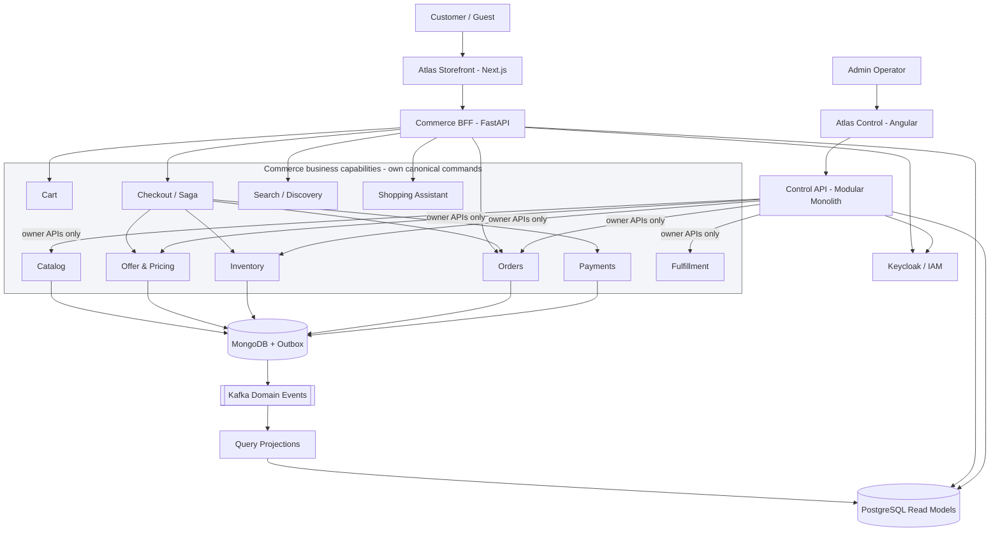

## 03-er-catalog.mmd

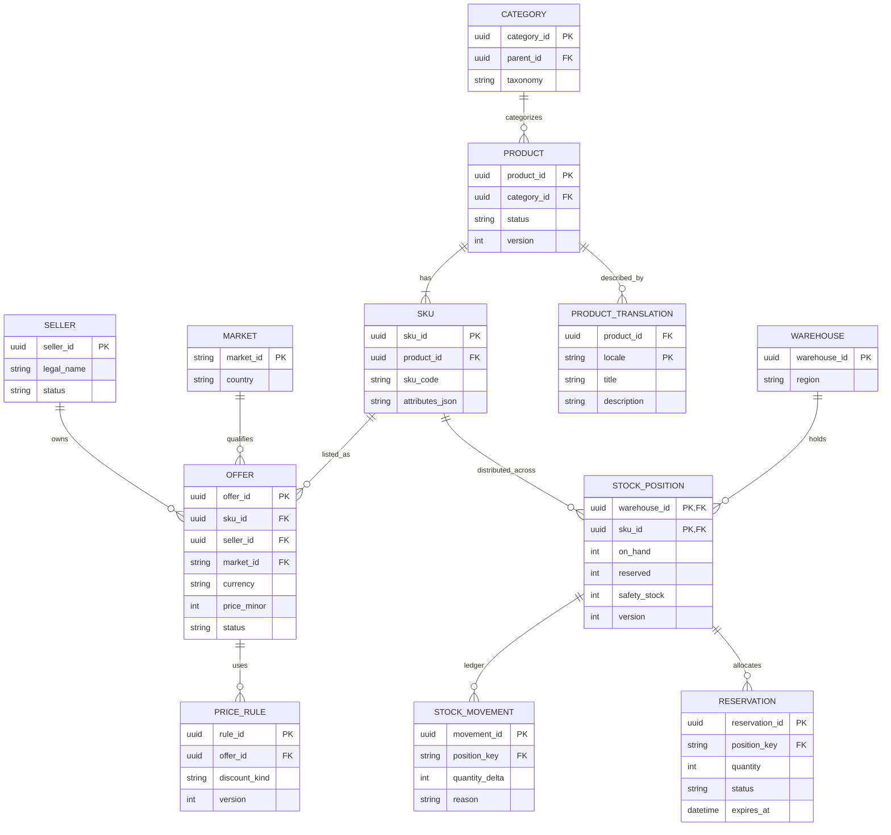

## 04-er-order-finance.mmd

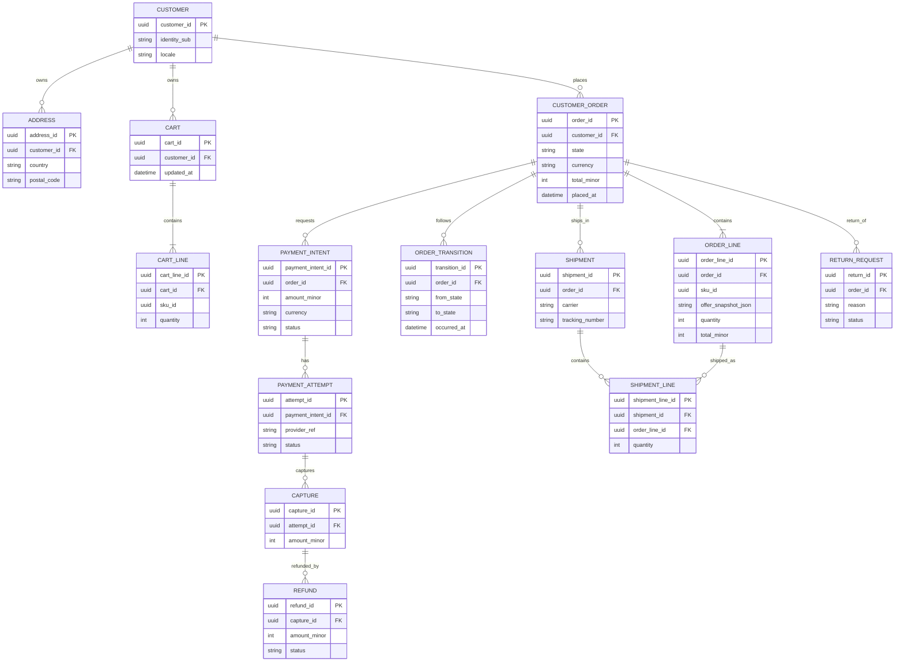

## 05-er-admin.mmd

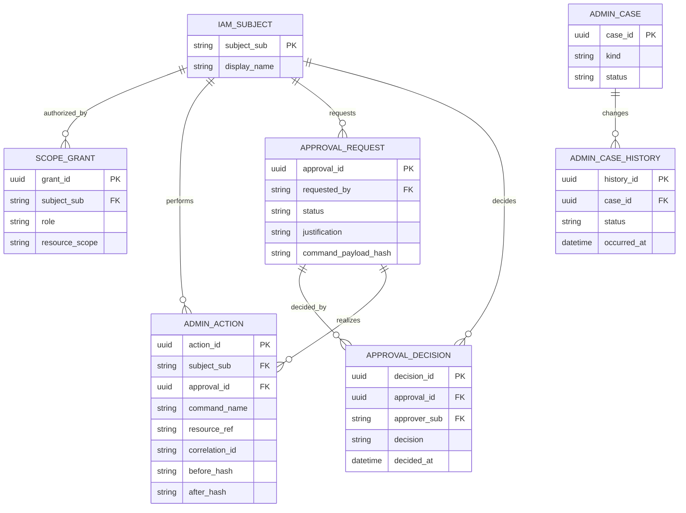

## 06-classes-order.mmd

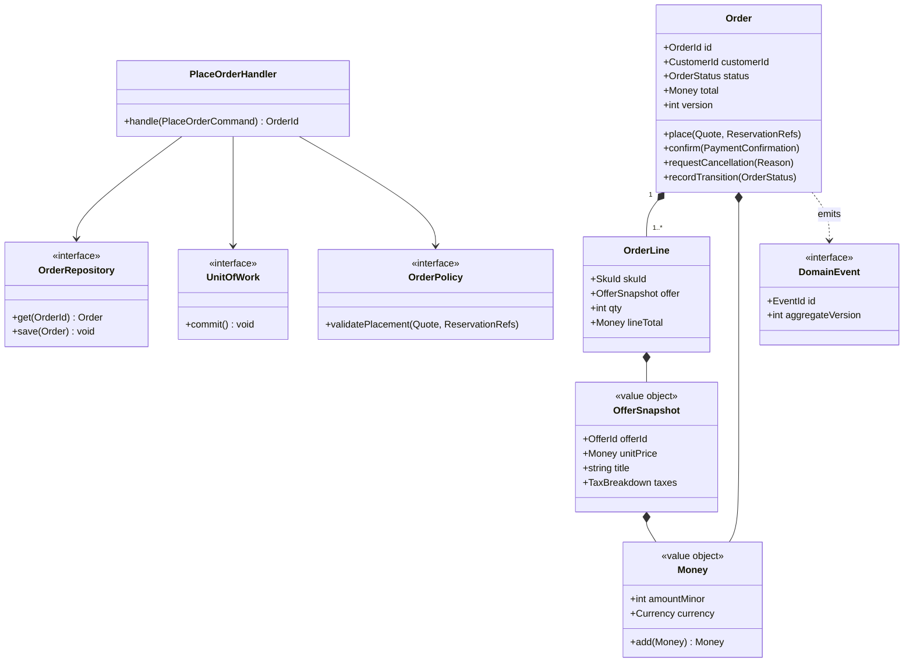

## 07-classes-inventory.mmd

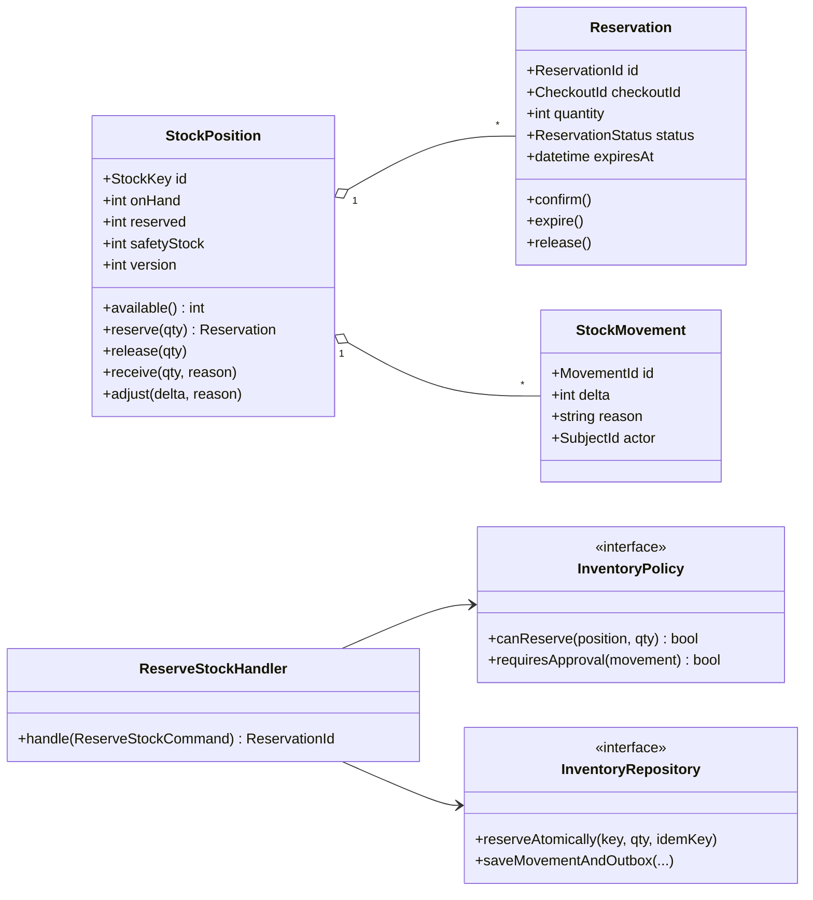

## 08-state-order.mmd

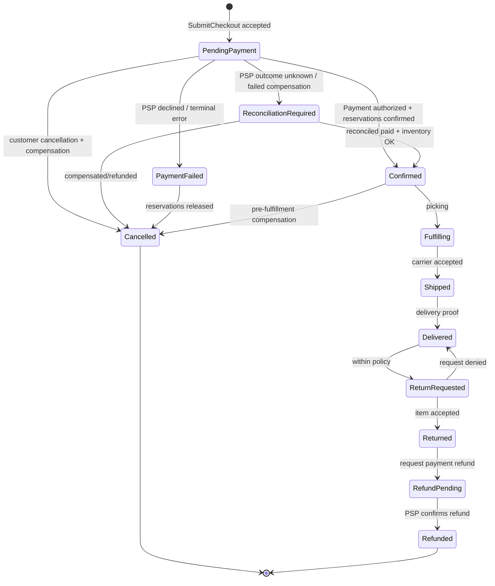

## 09-cqrs-projection.mmd

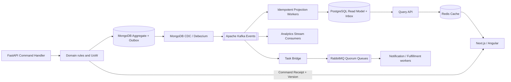

## 10-sequence-checkout.mmd

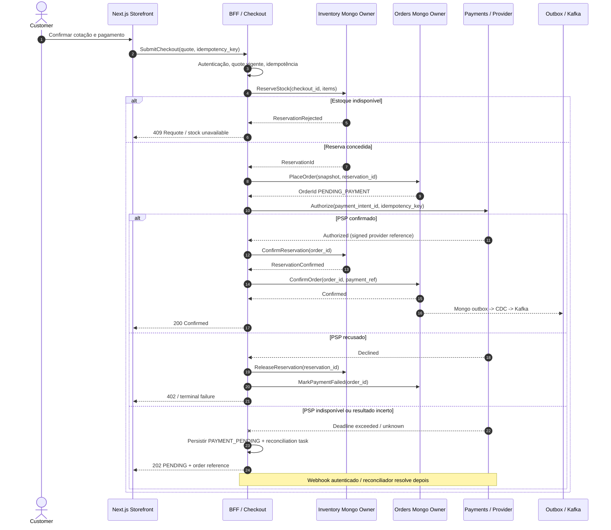

## 11-usecases-summary.mmd

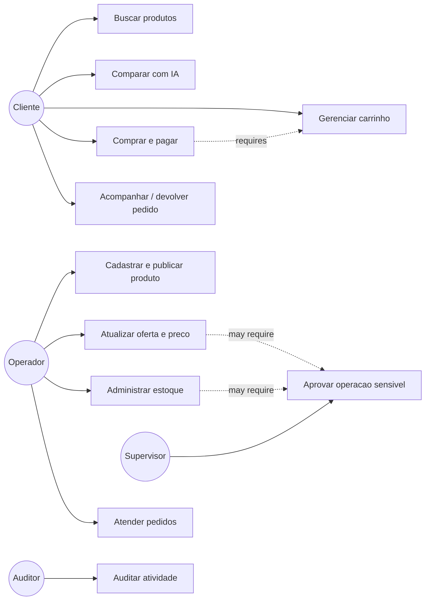

# Apêndice — Diagramas UML PlantUML editáveis

## 01-usecases-storefront.puml

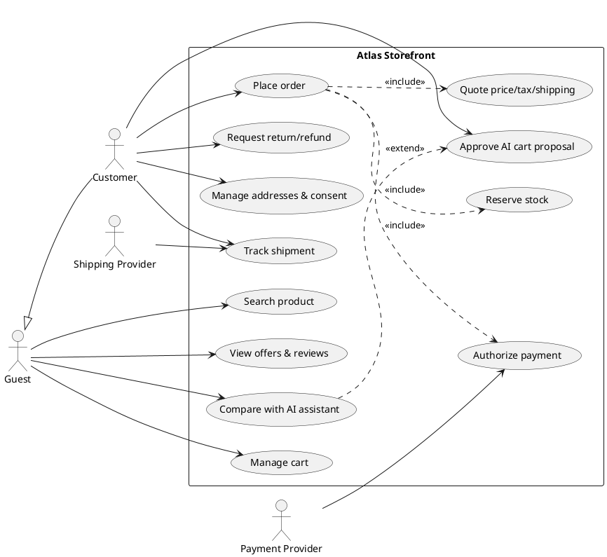

## 02-usecases-admin.puml

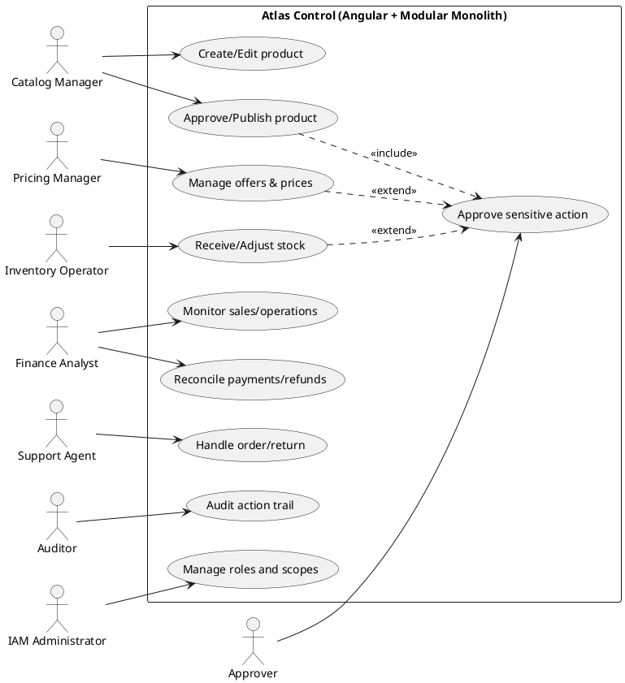

